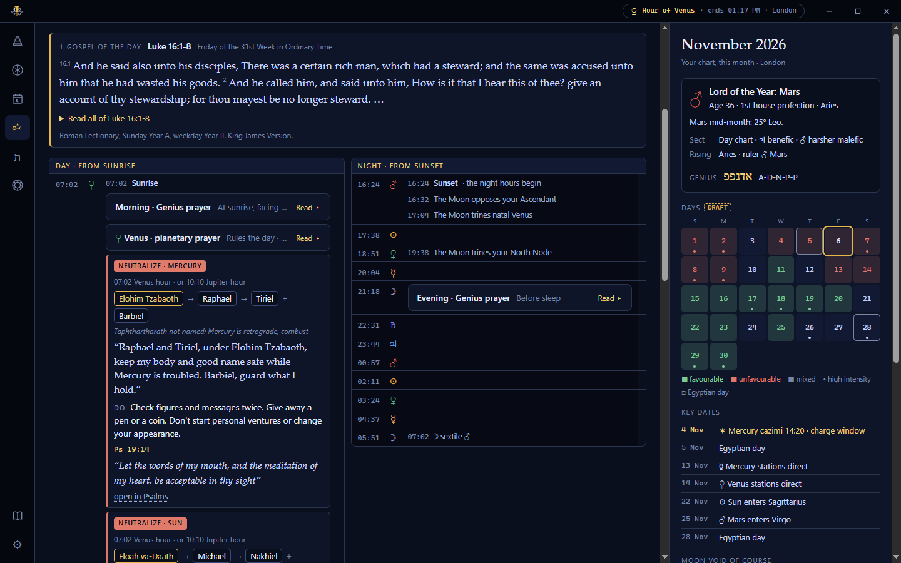
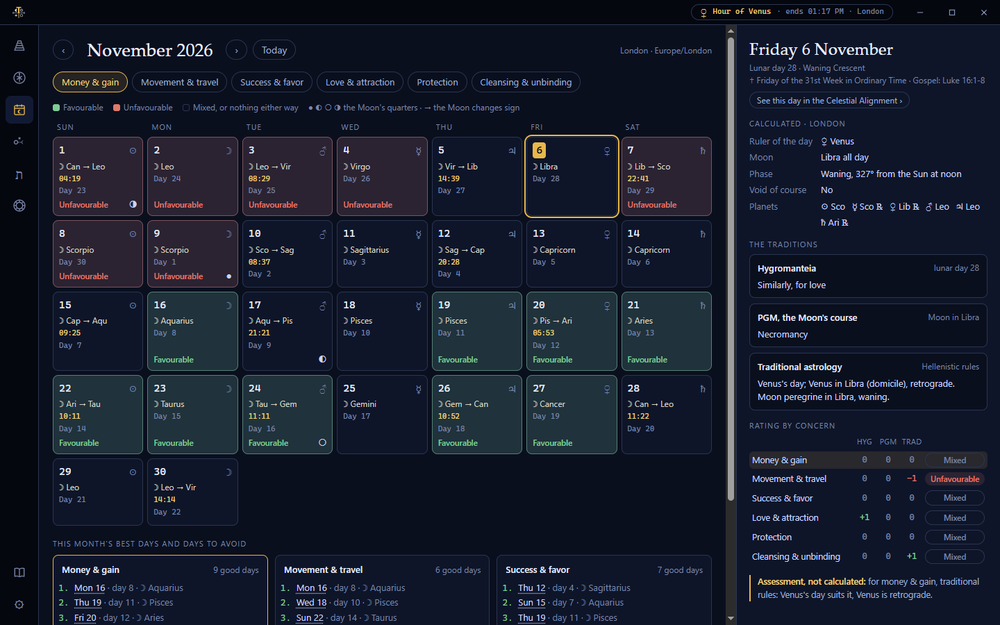
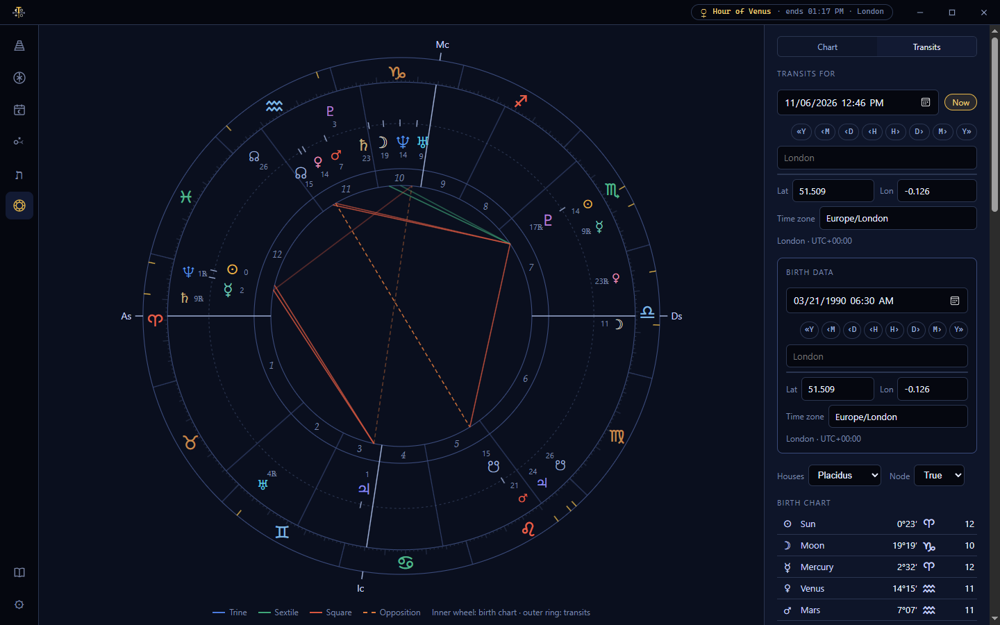

# FEMT Lite

FEMT Lite is the desktop edition of the Field Expedient Magical Toolkit for Windows, with six sections: the
Altar, Sigils, the Calendar, Celestial Alignment, the Psalms and the Chart. It works offline, and everything you
enter stays on your computer.

## Install

Download the newest `FEMT-Lite-Setup-<version>.exe` from the
[latest release](https://github.com/jamy-sky/femt-releases/releases/latest) and run it. Windows may warn that the
publisher is unknown, because the installer isn't signed with a Windows certificate: choose **More info**, then
**Run anyway**. FEMT Lite installs for your Windows account only and doesn't need administrator rights.

## Updates

FEMT Lite checks for a newer version each time it starts. When there is one, the title bar shows
**FEMT Lite x.y.z is ready** with **Install and restart** and **Later**. Nothing installs until you choose it,
and your notes are saved first.

## First steps

1. **Settings → General:** choose the city nearest you. Planetary hours, sunrise and the Calendar's days use it.
2. **Chart → Transits:** enter your birth date, time and place. Celestial Alignment and the Altar need it.
3. **Settings → Alignment:** your name, your mother's maiden name and, if you like, how you say your Genius's
   name. They fill in the prayers and stay on this computer.

## The sections

- **Altar:** three altars of four tiers (Divine, Celestial, Terrestrial, Chthonic). Add your own images of the
  saints, powers and archetypes you work with, and arrange them. Figures named in the day's prayers glow.
- **Sigils:** a whiteboard for your sigils. Add them from image files or drop them on the board, drag to arrange,
  pull a corner to resize, and remove what you no longer want. The board can be light or dark.
- **Calendar:** the month's fortunate and unfortunate days for money, travel, success, love, protection and
  cleansing, from the lunar days and the Moon's course.
- **Celestial Alignment:** each day from your birth chart: whether it leans well or badly, which houses of life it
  touches, what to magnify or guard against and in which planetary hour, with the prayer chain and a psalm for
  each. The Clock shows the day and night hours side by side, with the Genius, planetary and mansion prayers in
  their hours, and the gospel of the day above them.
- **Psalms:** all 150 in the King James Version with the Hebrew and its pronunciation, and their traditional uses
  and holy names after Selig's *Secrets of the Psalms*, which you can browse by need.
- **Chart:** your birth chart and today's transits.
- **Prayers** (the book above Settings): every prayer FEMT Lite uses, to reword as you like. Restoring one brings
  back the original.

## A look inside

These show an example person born in London; yours will show your own chart and city.

**Celestial Alignment**, on the Clock: the gospel of the day, then the day and night hours side by side, with the
prayers and action items in their hours and the month on the right.

**Calendar:** the month rated for one concern at a time, with the chosen day's lunar day, the Moon's course and how
each tradition rates it.

**Chart:** the birth chart in the inner wheel and today's transits around it.

## Phone alerts (ntfy)

FEMT Lite can send Celestial Alignment's action windows to your phone through [ntfy](https://ntfy.sh), a free
notification service. Each alert is queued on the ntfy server up to three days ahead, so it arrives on time even
when your PC is off.

1. **Install ntfy on your phone:** from the Google Play Store or the Apple App Store, search for "ntfy".
2. **Choose a topic name:** a topic is like a private channel name. On the public ntfy.sh server anyone who knows
   or guesses the name can read it, so make it long and hard to guess, such as `femt-` followed by random letters
   and numbers. Don't use your name.
3. **Subscribe on your phone:** in the ntfy app, tap **+**, enter the same topic name, and leave the server as
   ntfy.sh.
4. **Connect FEMT Lite:** open **Settings → Phone alerts**, enter the topic, and leave the server blank for
   ntfy.sh. If you run your own ntfy server or use a protected topic, enter its address and access token too.
5. **Test it:** choose **Send a test**. A notification should reach your phone within seconds.
6. **Choose what to send:** the action items you want (Magnify, Strengthen, Neutralize, Restrain, Settle), and if
   you like an alert as the Moon enters each lunar mansion, with its prayer.

FEMT Lite queues the next few days' alerts while it is open, and again every half hour. **Alerts on / off** pauses
them; alerts already queued on the server still arrive. Alerts carry the action and its time, never your name or
birth details.

## Your data

Everything you enter is kept in `%APPDATA%\femt-lite`: your notes, settings, prayers, altar and sigil images. The
path is shown in **Settings → Notes & sources**. To move to another PC, copy that folder while FEMT Lite is closed.
Uninstalling FEMT Lite leaves it in place.

## Sources

The KJV (1769) is in the public domain. The Hebrew text and pronunciation are from STEPBible.org's TAHOT (CC BY
4.0). Selig's uses are summarised in new words, and his prayers are given in brief, not quoted. Planetary
correspondences and lunar mansions follow Agrippa's *Three Books of Occult Philosophy* (1651) and the
*Heptameron*. The gospel of the day follows the Roman Lectionary, in the KJV. Place names are from GeoNames
(CC BY 4.0). The fonts are Atkinson Hyperlegible Next and Lexend (SIL Open Font License). The full list is in
**Settings → Notes & sources**. The prayers are FEMT's own drafts, yours to change.
